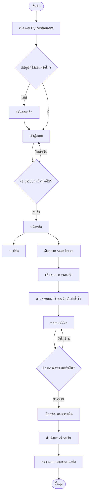

# PyRestaurant

**ระบบจัดการร้านอาหารบนเดสก์ท็อป** พัฒนาด้วย Python, CustomTkinter และ SQLite  
โครงงานประกอบรายวิชา *Fundamental Programming Concepts* มหาวิทยาลัยเกษตรศาสตร์ วิทยาเขตศรีราชา

---

## ภาพรวมโครงการ

PyRestaurant เป็นแอปพลิเคชันเดสก์ท็อปสำหรับสาธิตขั้นตอนการใช้งานระบบร้านอาหาร ตั้งแต่การจัดการบัญชีผู้ใช้ การจองโต๊ะ การเลือกอาหารและจัดการตะกร้า ไปจนถึงการตรวจสอบบิลและดำเนินการชำระเงิน

## ความสามารถหลัก

| โมดูล | รายละเอียด |
|---|---|
| บัญชีผู้ใช้ | สมัครสมาชิกและเข้าสู่ระบบ |
| การจองโต๊ะ | เลือกวันและช่วงเวลา พร้อมตรวจสอบรายการจอง |
| การสั่งอาหาร | เลือกรายการอาหารและจำนวนที่ต้องการ |
| ตะกร้าสินค้า | ตรวจสอบรายการและยอดรวมก่อนยืนยันคำสั่งซื้อ |
| ตรวจสอบบิล | แสดงรายการสั่งซื้อและยอดค้างชำระ |
| การชำระเงิน | มีหน้าจอให้เลือกช่องทางชำระเงิน |

> **ข้อควรทราบ:** จากการตรวจโค้ดเบื้องต้น พบว่าหน้าจอแสดงช่องทางชำระเงินที่เลือก แต่การเรียก `data.pay_bill_user(current_user)` ไม่ได้ส่งค่าช่องทางดังกล่าวไปด้วย จึงยังยืนยันไม่ได้ว่าระบบบันทึกวิธีชำระเงินจริง

## User Flow

แผนภาพต่อไปนี้แสดงลำดับการใช้งานโดยทั่วไป โดยอ้างอิงจากหน้าจอและฟังก์ชันที่พบในโค้ด ไม่ใช่การยืนยันว่าทุกกรณีได้รับการทดสอบแล้ว



## เทคโนโลยี

- **Python 3.10+** — ภาษาหลักของโปรเจกต์
- **CustomTkinter** — ส่วนติดต่อผู้ใช้แบบเดสก์ท็อป
- **tkcalendar** — ส่วนเลือกวันที่
- **SQLite** — ฐานข้อมูลภายในเครื่อง

## ข้อกำหนดเบื้องต้น

ก่อนเรียกใช้งาน ควรตรวจสอบว่ามีรายการต่อไปนี้ครบถ้วน

- Python 3.10 หรือใหม่กว่า
- โมดูล `main.py`, `order.py`, `logic.py` และ `data.py` ตามที่มีการนำเข้าในโค้ด
- ฐานข้อมูล `database/database.db` พร้อมตารางและข้อมูลเริ่มต้นที่แอปต้องใช้

โครงสร้างตัวอย่างที่คาดหวัง:

```text
project/
├── main.py
├── order.py
├── logic.py
├── data.py
└── database/
    └── database.db
```

> โครงสร้างข้างต้นเป็นตัวอย่างที่อนุมานจากชื่อโมดูลและ path ในโค้ด ไม่ใช่การยืนยันว่าไฟล์ทั้งหมดมีอยู่ในชุดส่งมอบ และ README ต้นฉบับยังไม่มีขั้นตอนสร้าง schema ฐานข้อมูล

## การติดตั้ง

1. เปิด Terminal หรือ Command Prompt ในโฟลเดอร์โปรเจกต์
2. ติดตั้งไลบรารีที่จำเป็น

   ```bash
   python -m pip install customtkinter tkcalendar
   ```

3. ตรวจสอบว่ามีโมดูลที่นำเข้าและไฟล์ฐานข้อมูลครบถ้วน

หากมีไฟล์ `requirements.txt` ที่ดูแลรายการ dependency ไว้แล้ว สามารถติดตั้งด้วยคำสั่งนี้:

```bash
python -m pip install -r requirements.txt
```

## การเรียกใช้งาน

รันคำสั่งต่อไปนี้จากโฟลเดอร์ที่มี `main.py`:

```bash
python main.py
```

หากพบ `ModuleNotFoundError` ให้ตรวจสอบโมดูลที่ขาดและสภาพแวดล้อม Python ที่ใช้งาน หากพบข้อผิดพลาดเกี่ยวกับ SQLite ให้ตรวจสอบตำแหน่งไฟล์ฐานข้อมูลและตารางที่แอปต้องใช้

## ขั้นตอนใช้งานโดยย่อ

1. สมัครสมาชิกหรือเข้าสู่ระบบ
2. ไปที่หน้า **Booking** เพื่อเลือกวัน เวลา และจองโต๊ะ (หากต้องการ)
3. ไปที่หน้า **Order** เพื่อเลือกอาหารและจำนวน
4. เปิด **Cart** เพื่อตรวจสอบรายการและยืนยันคำสั่งซื้อ
5. เปิด **Check Bill** เพื่อตรวจสอบยอดค้างชำระ
6. เลือกช่องทางชำระเงินและตรวจสอบสถานะบิล

ชื่อเมนูและข้อความในแอปอาจมีทั้งภาษาไทยและภาษาอังกฤษ

## ประเด็นที่ควรปรับปรุงก่อนใช้งานจริง

รายการต่อไปนี้มาจากการตรวจโค้ดแบบ static เบื้องต้น ควรยืนยันด้วยการทดสอบและตรวจสอบไฟล์โมดูลที่เกี่ยวข้องอีกครั้ง

- **ความปลอดภัยของรหัสผ่าน:** โค้ดที่ตรวจพบเปรียบเทียบชื่อผู้ใช้และรหัสผ่านกับฐานข้อมูลโดยตรง ควรใช้ password hashing ที่เหมาะสมและวางแผนย้ายข้อมูลบัญชีเดิม
- **ความถูกต้องของการจอง:** ตรวจสอบช่วงเวลาที่ทับซ้อนกัน และป้องกันการจองโต๊ะเดียวกันพร้อมกัน
- **ความครบถ้วนของคำสั่งซื้อ:** บันทึกรายการอาหารหลายรายการใน transaction เดียว เพื่อป้องกันข้อมูลบางส่วนถูกบันทึกเมื่อเกิดข้อผิดพลาด
- **การชำระเงิน:** ส่งและบันทึกช่องทางชำระเงินอย่างชัดเจน พร้อมตรวจสอบสถานะการชำระก่อนปิดบิล
- **การจัดการฐานข้อมูล:** ปิด connection อย่างปลอดภัยทุกเส้นทาง และจัดเตรียมสคริปต์สร้าง schema/ข้อมูลเริ่มต้น
- **การแยกส่วนโค้ด:** แยก UI, business logic และ data access ให้มีหน้าที่ชัดเจน รวมถึงลดฟังก์ชันซ้ำซ้อน
- **การทดสอบ:** เพิ่มการทดสอบกรณีเข้าสู่ระบบผิดพลาด การจองซ้ำ การแก้ไขตะกร้า การคำนวณบิล และการชำระเงิน

## ขอบเขตการตรวจสอบ

การตรวจที่ใช้ประกอบ README นี้เป็นการอ่านโค้ดและตรวจไวยากรณ์ Python เบื้องต้นเท่านั้น ยังไม่ได้ยืนยันการทำงานจริงของทุกหน้าจอ ไม่ได้ตรวจ schema ฐานข้อมูลครบถ้วน และไม่ได้ทดสอบ integration กับโมดูลทั้งหมด

## ผู้จัดทำ

- นาย ธนากร ขนทอง
- นาย แทนโชค สังข์วัย
- นางสาว กฤษยารัตน์ กลิ่นพิพัฒน์

**รายวิชา:** Fundamental Programming Concepts  
**สถาบัน:** มหาวิทยาลัยเกษตรศาสตร์ วิทยาเขตศรีราชา
