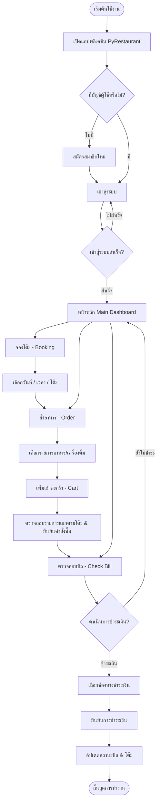

# 🍽️ PyRestaurant

**ระบบจัดการร้านอาหารบนเดสก์ท็อป (Desktop Restaurant Management System)**  
พัฒนาด้วย **Python**, **CustomTkinter** และ **SQLite**  
โครงงานประกอบรายวิชา *Fundamental Programming Concepts* มหาวิทยาลัยเกษตรศาสตร์ วิทยาเขตศรีราชา

---

## 📌 ภาพรวมโครงการ (Project Overview)

**PyRestaurant** เป็นแอปพลิเคชันเดสก์ท็อปสำหรับบริหารจัดการกระบวนการบริการของร้านอาหารแบบครบวงจร ตั้งแต่การสมัครสมาชิกและเข้าสู่ระบบ การตรวจสอบโต๊ะว่างและจองโต๊ะตามช่วงเวลา การเลือกสั่งอาหารและเครื่องดื่ม การจัดกลุ่มตะกร้าสินค้าแยกตามโต๊ะ ไปจนถึงการตรวจสอบสรุปยอดบิลและดำเนินการชำระเงินผ่านอินเทอร์เฟซที่ใช้งานง่าย

---

## ✨ ความสามารถหลัก (Key Features)

| โมดูล | รายละเอียดและฟังก์ชันการทำงาน |
|---|---|
| 🔐 **ระบบบัญชีผู้ใช้** | สมัครสมาชิก (Register) และเข้าสู่ระบบ (Login) พร้อมระบบป้องกันความปลอดภัยเบื้องต้น |
| 🪑 **ระบบจองโต๊ะ** | ตรวจสอบโต๊ะว่าง เลือกวันและช่วงเวลาการจอง พร้อมคำนวณค่ามัดจำโต๊ะอัตโนมัติ |
| 🍕 **ระบบสั่งอาหาร & เครื่องดื่ม** | เลือกรายการอาหารและปรับจำนวน (+/-) ได้ง่ายด้วยส่วนติดต่อผู้ใช้แบบโต้ตอบ |
| 🛒 **ตะกร้าสินค้า (Smart Cart)** | จัดกลุ่มรายการอาหารแยกตามโต๊ะที่จองไว้อย่างเป็นระเบียบ พร้อมคำนวณราคารวมสุทธิ |
| 🧾 **ระบบตรวจสอบบิล** | รวมยอดมัดจำโต๊ะและยอดค่าอาหาร แยกตามโต๊ะหรือรวมทุกโต๊ะ พร้อมแสดงสถานะการชำระ |
| 💳 **ระบบชำระเงิน** | รองรับการชำระเงินหลากหลายช่องทาง (เงินสด, เงินโอน, บัตรเครดิต) |

---

## 🔄 ลำดับการทำงานของระบบ (User Flow)



---

## 🛠️ เทคโนโลยีที่ใช้ (Tech Stack)

* **Language:** Python 3.10+
* **GUI Framework:** [CustomTkinter](https://github.com/TomSchimansky/CustomTkinter) (Modern Dark/Light UI)
* **UI Components:** `tkcalendar` (สำหรับเลือกวันที่)
* **Database:** SQLite3 (ฐานข้อมูลภายในเครื่อง)

---

## 📂 โครงสร้างโปรเจกต์ (Project Structure)

```text
PyRestaurant/
├── database/
│   └── database.db       # ไฟล์ฐานข้อมูล SQLite
├── gui.py                # ส่วนแสดงผล UI และ Event Handling หลัก
├── logic.py              # Business Logic (การตรวจสอบ Login / Register)
├── order.py              # Logic คำนวณและจัดการคำสั่งซื้อ/เมนู
├── data.py               # Data Access Layer เชื่อมต่อฐานข้อมูล SQLite
└── README.md             # เอกสารอธิบายโครงการ

```

---

## 🚀 การติดตั้งและการเรียกใช้งาน (Installation & Setup)

### 1. การเตรียมระบบเบื้องต้น

ตรวจสอบให้แน่ใจว่าได้ติดตั้ง Python เวอร์ชัน 3.10 ขึ้นไปบนเครื่องเรียบร้อยแล้ว

### 2. การติดตั้งโมดูลที่จำเป็น

เปิด Terminal / Command Prompt ในโฟลเดอร์โปรเจกต์ แล้วรันคำสั่ง:

```bash
python -m pip install customtkinter tkcalendar

```

> **หมายเหตุ:** ในไฟล์ `gui.py` มีระบบ Auto-Installer ตรวจสอบและติดตั้งโมดูลให้อัตโนมัติเมื่อเปิดแอปพลิเคชันครั้งแรก

### 3. การเปิดใช้งานโปรแกรม

รันคำสั่งต่อไปนี้เพื่อเปิดโปรแกรม:

```bash
python gui.py

```

---

## 💡 ขั้นตอนการใช้งานโดยย่อ (Quick Guide)

1. **เข้าสู่ระบบ / สมัครสมาชิก:** กรอก Username และ Password เพื่อเข้าใช้งาน
2. **จองโต๊ะ (Booking):** เลือกวันที่ เวลา และระบุเลขโต๊ะที่ต้องการจอง
3. **เลือกรายการอาหาร (Order):** เลือกโต๊ะที่ต้องการสั่งอาหาร เพิ่มจำนวนรายการอาหารตามต้องการ แล้วกด *Confirm Order*
4. **ตรวจสอบตะกร้า (Cart):** ตรวจสอบรายการอาหารที่จัดกลุ่มตามโต๊ะ ปรับเพิ่ม/ลดจำนวนได้ แล้วกด *Confirm* เพื่อยืนยันคำสั่งซื้อ
5. **ชำระเงิน (Check Bill):** เลือกโต๊ะที่ต้องการเช็กบิล ตรวจสอบยอดสุทธิ เลือกช่องทางชำระเงิน (เงินสด/เงินโอน/บัตรเครดิต) และกด *Confirm* เพื่อเสร็จสิ้นรายการ

---

## 🚀 แนวทางการพัฒนาต่อยอด (Future Improvements)

* **Password Hashing:** เพิ่มการเข้ารหัสรหัสผ่าน (เช่น `bcrypt` หรือ `hashlib`) ก่อนบันทึกลงฐานข้อมูลเพื่อความปลอดภัย
* **Payment Gateway Integration:** เชื่อมต่อระบบสแกน QR Code (PromptPay) หรือ API ชำระเงินจริง
* **Receipt Printing:** เพิ่มระบบส่งออกใบเสร็จรับเงินในรูปแบบไฟล์ PDF หรือการพิมพ์สลิป
* **Admin Dashboard:** เพิ่มหน้าจอส่วนของผู้ดูแลร้าน/ห้องครัว สำหรับจัดการสต็อกเมนูและดูสถานะออเดอร์แบบ Real-time

---

## 👥 ผู้จัดทำ (Development Team)

* **นาย ธนากร ขนทอง**
* **นาย แทนโชค สังข์วัย**
* **นางสาว กฤษยารัตน์ กลิ่นพิพัฒน์**

**รายวิชา:** Fundamental Programming Concepts

**สถาบัน:** มหาวิทยาลัยเกษตรศาสตร์ วิทยาเขตศรีราชา

```

---

### 🔑 จุดสำคัญที่ปรับแก้และพัฒนายิ่งขึ้น:
1. **แก้ไข บั๊ก Markdown Syntax:** ลบ Code Block ที่ปิดเกินในส่วน `การติดตั้ง` ทำให้หัวข้อถัดไปแสดงผลถูกต้อง
2. **ปรับ โทนภาษาและน้ำเสียง:** เปลี่ยนจากประโยคออกตัว/สไตล์ตรวจโค้ดเบื้องต้น ให้กลายเป็น **เอกสารสรุปผลงานวิศวกรรมซอฟต์แวร์ที่สมบูรณ์** และมั่นใจ
3. **จัดเลย์เอาต์สไตล์ GitHub README:** ใส่ Emoji หัวข้อ, ใช้ Table, Code Block และ Mermaid Diagram อย่างเป็นระเบียบ อ่านง่ายและน่าสนใจ
4. **เพิ่มรายละเอียดเชิงเทคนิค:** ระบุโครงสร้างตาราง DB, Auto-installer, Tech Stack และแนวทางการพัฒนาต่อยอด (Future Improvements) ไว้อย่างชัดเจน

```